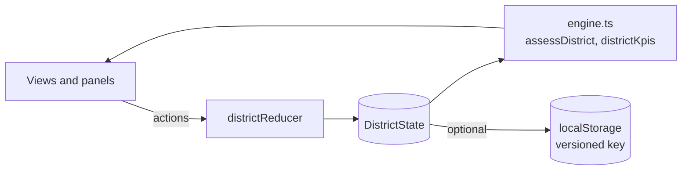

# District model, state store, and simulation clock

Dawai Dost models a full district supply network in the browser. This document describes the synthetic data, the state store, the actions that change state, and the simulation clock.

Source: [`lib/district/types.ts`](../../lib/district/types.ts), [`lib/district/data.ts`](../../lib/district/data.ts), [`lib/district/store.tsx`](../../lib/district/store.tsx), [`lib/district/engine.ts`](../../lib/district/engine.ts)

## Synthetic data

> **All facility data is synthetic.** The block names are real blocks of Sehore district, Madhya Pradesh. The facilities, people, phone numbers, coordinates, and stock counts are fictional. The code exports this notice as `SYNTHETIC_DATA_NOTICE`.

| Item | Count | Notes |
| --- | ---: | --- |
| Facilities | 23 | 1 district drug warehouse, 1 district hospital, 5 CHCs, 16 PHCs |
| Blocks | 6 | Sehore, Ashta, Ichhawar, Nasrullaganj, Budhni, Shyampur |
| Tracer medicines | 10 | Diabetes, hypertension, maternal, antibiotic, analgesic, respiratory, and nutrition |
| Stock records | 230 | One per facility and medicine |
| Weekly history | 12 weeks | Each record has a ledger of closing stock, dispensed, and received units |

The generator uses a seeded random function (`mulberry32`), so every load produces the same district. The seed clock is `2026-10-10T09:42:00+05:30`.

### Built-in cases

The seed data contains one example of each decision the system must handle.

| Case | Facility and medicine | Expected response |
| --- | --- | --- |
| Hero transfer | Saraswati PHC, Metformin 500 mg (2.0 days); Kalyanpur PHC has 45 safe strips | `transfer_surplus` |
| Second clinic on the same donor | Rampur PHC, Metformin 500 mg (1.5 days) | Shares Kalyanpur's surplus; indent for the rest |
| Near-expiry surplus | Anandpur PHC holds Amoxicillin that expires on 2026-10-28; Lakshmipura PHC is low | Transfer from Anandpur first |
| Suspicious count | Hirapur PHC reports 168 strips of Telmisartan; the ledger expects about 30 | `verify_count` |
| Indent | Kesarpura PHC is low on IFA; no clinic has IFA surplus, but the warehouse does | `draft_indent` |
| Stockout | Tulsipur PHC has no Salbutamol inhalers; CHC Nasrullaganj can spare | Transfer |
| District-wide shortage | Amlodipine 5 mg: the warehouse is empty, the upstream supplier is delayed, and no clinic has surplus | `escalate_supply_gap` |
| Stale reports | Bhimpura PHC and Narayanpur PHC have not reported for more than 8 days | Count check flags `stale_report` |

The seed state also has 5 transfers (delivered, in transit, approved, and proposed), 2 earlier decisions, and 22 timeline events.

## State store

The store is a React context with a reducer. All views read the same state.

`useDistrict()` returns:

| Field | Content |
| --- | --- |
| `state` | Facilities, medicines, stock, transfers, decisions, timeline, selection, and the simulated clock |
| `assessments` | One `StockAssessment` for each stock record, calculated from the current state |
| `kpis` | District totals for the KPI strip |
| `actions` | Typed helper functions for each action below |
| `getAssessment`, `getRecord` | Lookup by facility and medicine |

Persistence is off by default, so each page load starts from the seed. When `persist` is on, the store saves to `localStorage` under a versioned key. `RESET` clears it.

## Actions

| Action | Effect | Timeline entry |
| --- | --- | --- |
| `RECORD_VOICE_REPORT` | Sets the new count and its source (`voice`, or `manual` for keypad entries), updates the weekly ledger, runs the count check. Requests a recount if the check flags the count or the extraction confidence is below 0.6. | `voice_report`, then `recount_requested` or `count_verified`, and an `alert` if the record is now critical or out of stock |
| `REQUEST_RECOUNT` | Marks the count as not verified | `recount_requested` |
| `ADD_DECISION` | Adds a Decisions API result to the queue | `decision` |
| `SET_DECISION_STATUS` | Approve, reject, or acknowledge a decision. Approval also approves the linked transfer, opens a recount, drafts an indent, or logs an escalation, depending on the action. | `approval` or `rejection`, plus `recount_requested`, `indent`, or `escalation` |
| `PROPOSE_TRANSFER` | Adds a planned transfer | `transfer_update` |
| `SET_TRANSFER_STATUS` | Moves a transfer through `proposed → approved → in_transit → delivered`, or to `rejected`. Delivery moves the units between the two ledgers. | `approval`, `rejection`, or `transfer_update` |
| `CONFIRM_RECEIPT` | The receiving pharmacist counts what arrived. On a shortfall, the receiver gets only what arrived, the donor stays debited for the full quantity, and the donor is asked to recount. The received quantity cannot exceed what was sent. | `transfer_update` ("Receipt confirmed"), and `recount_requested` on a shortfall |
| `ADVANCE_CLOCK` | Moves simulated time forward (see below) | `transfer_update` and new `alert` entries |
| `RESET` | Restores the seed state | none |

Each timeline entry has a time, a kind, a title, and an actor, for example "Dr. Ananya Rao (DHO)", "R. Mishra (pharmacist)", or "Count check". The timeline keeps the newest 500 entries.

## Simulation clock

The demo has its own clock, `state.now`. `ADVANCE_CLOCK` moves it forward by a number of hours. In one step it:

1. **Consumes stock.** Each record loses its daily use for the elapsed time, in whole units. The count is anchored to the epoch, so many small steps give the same result as one large step.
2. **Moves transfers.** An approved transfer leaves 2 hours after approval and arrives after its ETA. Each change happens in time order. Delivery updates both ledgers.
3. **Raises alerts.** A record that crosses into `critical` or `stockout` creates a new alert.
4. **Rolls weekly history.** When the clock crosses a Monday (IST), the ledger opens a new week.

This lets a judge see a full transfer, from approval to delivery, in a few seconds.

The top bar has clock controls: advance 6 hours, advance one day, or play (2 simulated hours every 1.4 seconds). The command palette (Ctrl+K) has the same actions.

[`lib/district/simulation.ts`](../../lib/district/simulation.ts) can also replay a week as frames, with an **autopilot** policy that proposes and approves every planner transfer at each step. A test checks that the autopilot averts stockout-days compared with doing nothing. This is a simulation on synthetic data, not a measured outcome.
