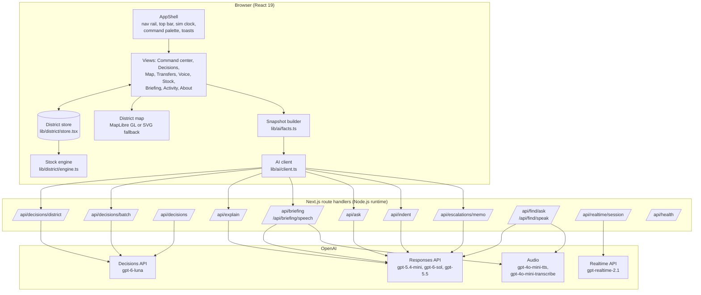

# System overview

Dawai Dost is a Next.js 16 application. One client-side district store feeds a set of officer views. Server route handlers call the OpenAI APIs. A deterministic engine computes every stock number.

## Main design principle

> **Code calculates. The model decides. The human approves.**

Each layer has one responsibility. No layer does the work of another.

## Components



| Component | Source | Responsibility |
| --- | --- | --- |
| App shell | [`components/shell/`](../../components/shell/AppShell.tsx) | Navigation, top bar, simulated clock controls, command palette, toasts. Holds the district store so state survives route changes. |
| District store | [`lib/district/store.tsx`](../../lib/district/store.tsx) | All district state and the actions that change it. See [District model and state](district-model.md). |
| Stock engine | [`lib/district/engine.ts`](../../lib/district/engine.ts) | Days of stock, risk, count check, donors, transfer planner, indent quantity, KPIs. See [Stock calculations](stock-math.md). |
| Snapshot builder | [`lib/ai/facts.ts`](../../lib/ai/facts.ts) | Facts-only decision snapshot and what-if edits for the Decisions API |
| AI client | [`lib/ai/client.ts`](../../lib/ai/client.ts) | Typed browser calls to the AI routes, with an NDJSON stream reader |
| Decisions layer | [`lib/ai/decide.ts`](../../lib/ai/decide.ts) | Question set, answer mapping, validation, and rule-based fallback |
| Responses layer | [`lib/ai/openai.ts`](../../lib/ai/openai.ts) | Model registry, SDK client, `generateStructured()` |
| Escalations | [`lib/escalations/`](../../lib/escalations/gap.ts) | Supply-gap detection, lead-time watch, escalation stages, memo facts |
| Find medicine | [`lib/find/`](../../lib/find/answer.ts) | Public availability bands, Hindi and English matching, spoken answers |
| District map | [`components/map/`](../../components/map/DistrictMap.tsx), [`lib/map/`](../../lib/map/model.ts) | Risk map, transfer arcs, week time-lapse |
| Evals | [`lib/evals/`](../../lib/evals/cases.ts), [`scripts/evals/run.ts`](../../scripts/evals/run.ts) | Labeled cases, live runner, metrics. See [Decision evals](../openai/evals.md). |

## End-to-end flow

1. The officer opens the command center. It shows how many clinics run out before resupply can reach them.
2. A pharmacist reports a count by voice. The store records it, runs the count check, and raises an alert if the clinic is critical.
3. For each at-risk clinic and medicine, the browser builds a facts-only snapshot and calls `/api/decisions/district` (or `/api/decisions/batch` for many).
4. The server asks the Decisions API six questions in one call, validates the answers, and returns a labeled `DecisionRecord`.
5. The decision appears in the AI inbox with its probabilities, urgency, and donor. The officer can ask `/api/explain` for a reason in English and Hindi.
6. The officer approves or rejects. Approval updates the linked transfer, opens a recount, drafts an indent, or logs an escalation.
7. The simulated clock moves time forward. The transfer leaves, travels, and arrives. Stock moves between the two ledgers.
8. Every step appears in the activity log with a time and an owner.

## Map rendering

The map has two renderers that draw from the same view model ([`lib/map/model.ts`](../../lib/map/model.ts)), so they always agree.

| Renderer | When | Notes |
| --- | --- | --- |
| MapLibre GL | Default | Uses the OpenFreeMap "positron" basemap, restyled at load time to the app palette. Shows a "Basemap offline" badge if tiles fail. |
| SVG | WebGL fails, or SVG is selected | Projects the district with d3-geo onto a stylised outline. Needs no network. |

One `requestAnimationFrame` loop ([`lib/map/animator.ts`](../../lib/map/animator.ts)) moves transfer markers along their arcs and tweens the displayed clock. Animation does not re-render React. The map respects the reduced-motion setting. A "Play week" control runs a 7-day time-lapse of stock and transfers.

## Fallbacks per feature

| Feature | Live path | Fallback | Label |
| --- | --- | --- | --- |
| District decision | Decisions API, six questions | Engine rules with a rule trace | `source: "demo_fallback"`, `engine: "rules"` |
| Batch decisions | Decisions API per item | Same rules per item | Per item |
| Explanation | Responses API | Template text | `source: "demo_fallback"` |
| Morning brief | Responses API | Template brief from the same summary | `source: "demo_fallback"` |
| Brief audio | TTS | Browser speech | HTTP 503 `fallback: "browser_speech"` |
| Ask the district | Responses API with tools | Keyword planner runs the same tools | `meta` event `demo_fallback` |
| Indent | Responses API writes text | Template justifications; quantities are always from code | `source: "demo_fallback"` |
| Escalation memo | Responses API with number check | Template memo | `source: "fallback"` |
| Find medicine parse | Responses API | Hindi and English lexicon parser | `source.parse: "fallback"` |
| Find medicine voice | Speech to text | Ask the person to type | HTTP 503 `fallback: "text"` |
| Find medicine audio | TTS | Browser speech | `fallback: "browser_tts"` |
| District map | MapLibre GL | SVG renderer | "Basemap offline" badge when tiles fail |
| Realtime session | Realtime API client secret | Scripted sample call | HTTP 503 or 502 |

## Technology choices

| Choice | Reason |
| --- | --- |
| **Next.js 16 App Router** | One codebase for views and server routes. Route handlers keep the API key on the server. |
| **Node.js runtime for routes** | Full SDK support, streaming responses, and error handling |
| **`openai` SDK** | Typed Decisions API params, `responses.parse()` with zod structured outputs, audio |
| **React context store** | One source of truth for all views. Pure reducer, so it is easy to test. |
| **MapLibre GL and d3** | Fast WebGL map with an offline SVG fallback; d3 for charts and projection |
| **zod** | Validates every route body and every structured output |
| **Vitest** | Fast unit tests with mocked OpenAI calls |
| **No database (prototype)** | The demo resets on reload. A database is the first item for a pilot. |

## Shared types

The domain contract is in [`lib/district/types.ts`](../../lib/district/types.ts). The four actions are defined once:

```ts
export type DecisionAction = "verify_count" | "transfer_surplus" | "draft_indent" | "escalate_supply_gap";
```

The same list feeds the Decisions API `choices`, the server validation, the probability map, the eval labels, and the interface labels.
