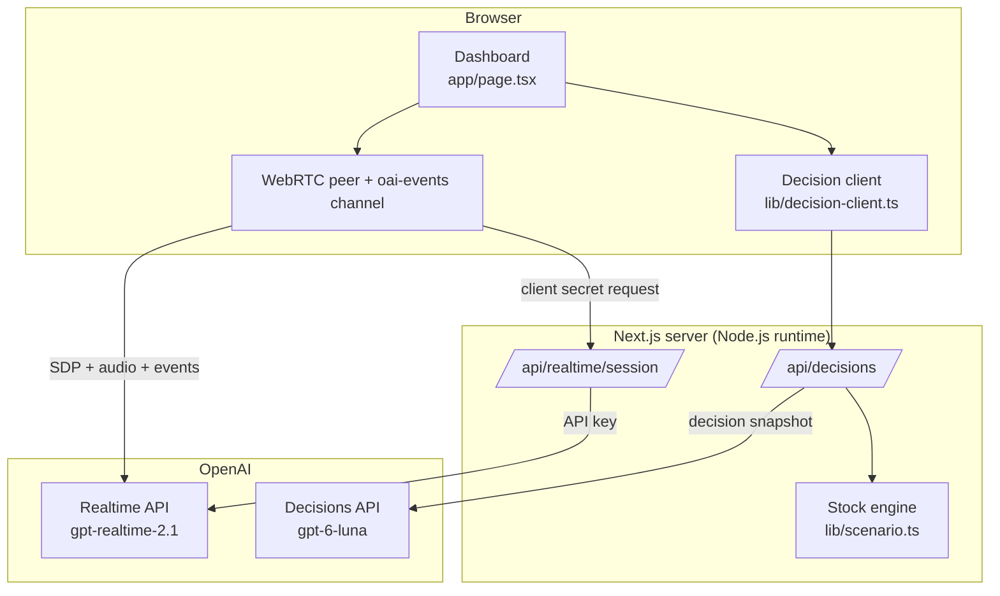

# System overview

Dawai Dost is a Next.js 16 application with two server routes and one dashboard. It connects the OpenAI Realtime API and the OpenAI Decisions API with a deterministic stock engine.

## Main design principle

> **Code calculates. The model decides. The human approves.**

Each layer has one responsibility. No layer does the work of another.

## Components



| Component | File | Responsibility |
| --- | --- | --- |
| Dashboard | [`app/page.tsx`](../../app/page.tsx) | Alerts, voice call, decision card, approval, timeline |
| Decision client | [`lib/decision-client.ts`](../../lib/decision-client.ts) | Typed call from the browser to `/api/decisions` |
| Stock engine | [`lib/scenario.ts`](../../lib/scenario.ts) | Scenario data, days of stock, safe surplus, decision snapshot, fallback |
| Decisions route | [`app/api/decisions/route.ts`](../../app/api/decisions/route.ts) | Calls the Decisions API, validates the answer, returns a labeled result |
| Realtime route | [`app/api/realtime/session/route.ts`](../../app/api/realtime/session/route.ts) | Creates a short-lived Realtime client secret |

## End-to-end flow

1. The officer opens the dashboard. It shows one clinic that needs a plan.
2. The officer starts the pharmacist call.
3. The browser gets a client secret from `/api/realtime/session` and opens a WebRTC session with the Realtime API.
4. The Realtime model answers each caller question in Hindi. The transcript streams onto the screen.
5. When the call ends, the dashboard sends the clinic data to `/api/decisions`.
6. The server calculates days of stock and safe surplus, builds a decision snapshot, and calls the Decisions API.
7. The server validates the answer and returns the action, confidence, and probabilities.
8. The dashboard shows the recommended action, the probabilities, and the transfer plan.
9. The officer approves. The accountability timeline records the step.

## Technology choices

| Choice | Reason |
| --- | --- |
| **Next.js 16 App Router** | One codebase for the dashboard and the server routes. Route handlers keep the API key on the server. |
| **Node.js runtime for routes** | Standard `fetch` to OpenAI with full error handling |
| **React 19** | Simple state for a live call, a pending decision, and an approval |
| **TypeScript** | One `DecisionAction` type is shared by the stock engine, the route, and the UI. An invalid action cannot compile. |
| **WebRTC for audio** | Lowest latency for a natural voice conversation, directly between browser and OpenAI |
| **No database (prototype)** | The demo resets in one click. A database is the first item for a pilot. |
| **Vitest** | Fast unit tests for stock rules and route behavior, with mocked OpenAI calls |

## Shared types

The four actions are defined once in `lib/scenario.ts`:

```ts
export type DecisionAction = "verify_count" | "transfer_surplus" | "draft_indent" | "escalate_supply_gap";
```

The same list feeds the Decisions API `choices`, the server validation, the probability map, and the dashboard labels. When we add an action, we change one place.
