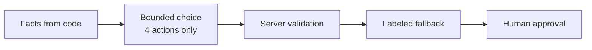

# Reliability and safety

A tool for public health operations must work every time, and it must never show wrong information as true. Dawai Dost is designed with layered safety.

## Safety layers

| Layer | Protection |
| --- | --- |
| **Facts from code** | Stock values and surplus are calculated in code. A model cannot invent a number. |
| **Bounded choice** | The Decisions API can select only one of four defined actions. |
| **Server validation** | The server accepts the answer only if it names a defined action. |
| **Labeled fallback** | If any step fails, the server returns a deterministic result, clearly labeled as demo data. |
| **Human approval** | No action takes effect until the district officer approves it. |

## Fallback behavior

The Decisions route always returns a usable result. The `source` field tells the dashboard where it came from.

| Condition | `source` | `fallbackReason` | Dashboard message |
| --- | --- | --- | --- |
| Valid live answer | `live` | none | "LIVE API RESULT" |
| No API key | `demo_fallback` | `missing_api_key` | Live credentials are unavailable |
| API returns an error status | `demo_fallback` | `upstream_unavailable` | The live decision service returned an error |
| Answer is missing or not a defined action | `demo_fallback` | `unexpected_response` | The live decision could not be parsed |
| Network or runtime error | `demo_fallback` | `request_failed` | Could not reach the decision service |

The fallback uses the same stock rules. If a nearby clinic has safe surplus, it selects `transfer_surplus`. If not, it selects `draft_indent`. Its probability values are fixed examples and are labeled as demo data.

The voice call has a matching fallback. If the Realtime session cannot start, does not connect in 12 seconds, or sends an error, the dashboard plays a labeled sample call and continues.

## Key handling

- The OpenAI API key is read from `OPENAI_API_KEY` on the server only.
- The browser never receives the key.
- For voice, the server creates a **short-lived client secret**. The browser uses it to open one Realtime session.
- `.env.local` is excluded from git.

## Input handling

The Decisions route rejects a request with invalid JSON or an empty clinic list, with HTTP 400. Server logs record upstream errors without the API key or the full payload.

## Human in the loop

Every action needs approval from the district officer. The dashboard shows:

- the recommended action
- the probability for each of the four actions
- the evidence: counts, daily use, days of stock, safe surplus
- whether the result is live or demo data

The officer can see why the system recommends an action before approving it. This keeps clear accountability for each medicine movement.

## Production additions

For a pilot, we will add:

- user accounts with roles (officer, pharmacist, state viewer)
- a database for reports, decisions, and approvals, with a durable audit log
- schema and range validation for every clinic field
- monitoring of Decisions API latency, fallback rate, and probability distribution
