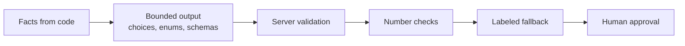

# Reliability and safety

A tool for public health operations must work every time, and it must never show wrong information as true. Dawai Dost is designed with layered safety.

## Safety layers

| Layer | Protection |
| --- | --- |
| **Facts from code** | Stock values, gaps, surplus, donor eligibility, transfer quantities, and indent quantities are calculated in code. A model cannot invent a number. |
| **Bounded output** | The Decisions API can select only one of four actions, and only an offered donor or `false`. Responses API features return strict JSON schemas; ids are enums from the district catalogue. |
| **Server validation** | Every route validates its request with zod. Every model answer is checked again on the server before use. |
| **Number checks** | The escalation memo is rejected if it contains any number that is not in the computed facts. Indent quantities are never taken from the model. |
| **Labeled fallback** | If any step fails, the server returns a deterministic result, clearly labeled. |
| **Human approval** | No transfer, recount, indent, or escalation takes effect until the district officer approves it. |

## Decisions API fallback

The district route always returns a usable result. The `source` field tells the interface where it came from.

| Condition | `source` | `fallbackReason` |
| --- | --- | --- |
| Valid live answer | `live` | none |
| No API key | `demo_fallback` | `missing_api_key` |
| API returns an error status | `demo_fallback` | `upstream_unavailable` |
| Answer missing, refused, or not a defined action | `demo_fallback` | `unexpected_response` |
| Network or runtime error, or 20-second timeout | `demo_fallback` | `request_failed` |

The fallback uses the engine rules: verify a doubtful count, transfer when a donor covers most of the gap, escalate when upstream supply is delayed or the warehouse is short, otherwise draft an indent. Its record has `engine: "rules"` and a `ruleTrace` that lists which rules fired. Its probabilities are fixed templates. The interface labels it **Rules fallback**.

The eval set measures this fallback too. On the current code it chooses an acceptable action on all 50 labeled cases. The rules were tuned on this set, so this is a consistency check, not an independent benchmark. See [Decision evals](../openai/evals.md).

## Fallbacks for other features

Every AI feature has a labeled fallback. The full table is in [System overview](overview.md#fallbacks-per-feature).

- **Responses API features** (explain, brief, ask, indent, memo, extraction, gloss, Find parsing) return template text or a deterministic parser result, with a `fallback` or `demo_fallback` label.
- **Audio** routes return HTTP 503 or 502 with a `fallback` hint (`browser_speech`, `browser_tts`, or `text`). The client then uses the browser's speech engine, or asks the person to type.
- **Realtime voice** switches to a call labeled **Sample call · scripted** if the session cannot start, the microphone is blocked, the connection does not open within 12 seconds, or the API sends an error before the conversation starts.
- **The map** switches to an SVG renderer if WebGL fails, and shows **Basemap offline** if the tiles do not load.

## Count safety

- The count check compares every new count with the weekly ledger. A flagged count is not verified, and a recount is requested.
- A voice report with extraction confidence below 0.6 also triggers a recount.
- The voice agent checks each number with `check_count` before it reads the number back. It never reveals the expected number, so it cannot lead the pharmacist.
- A record with an open recount or a flagged count cannot act as a donor, and the planner does not send it stock.

## Key handling

- The OpenAI API key is read from `OPENAI_API_KEY` on the server only. All OpenAI calls run in Node.js route handlers.
- The browser never receives the key.
- For voice, the server creates a **short-lived client secret** that expires after 10 minutes. The browser uses it to open one Realtime session.
- `GET /api/health` reports whether a key is configured. It never returns the key.
- `.env.local` is excluded from git.

## Privacy

- All data in the prototype is synthetic.
- The public Find medicine page receives availability bands (`available`, `low`, `out`), never shelf counts. A test checks this.
- The server-side copy of the district state for Ask and Indent removes pharmacist phone numbers.
- Voice extraction and transcript gloss calls use `store: false`.
- Server logs record upstream error codes, not the API key or full payloads.

## Human in the loop

Every action needs approval from the district officer. The decision card shows:

- the recommended action and the probability for each of the four actions
- a warning when the top two actions are within 15 points
- the evidence: counts, daily use, days of stock, gap, safe surplus, count check, upstream status
- the supporting signals: urgency, recount need, indent timing, transfer coverage
- whether the result is live or a fallback

The officer can see why the system recommends an action before approving it. Each decision in the activity log keeps the exact snapshot sent to the model, so any recommendation can be audited later.

## Production additions

For a pilot, we will add:

- user accounts with roles (officer, pharmacist, state viewer)
- a database for reports, decisions, approvals, and escalations, with a durable audit log
- monitoring of Decisions API latency, fallback rate, and probability distribution
- a regular live eval run, with results published
