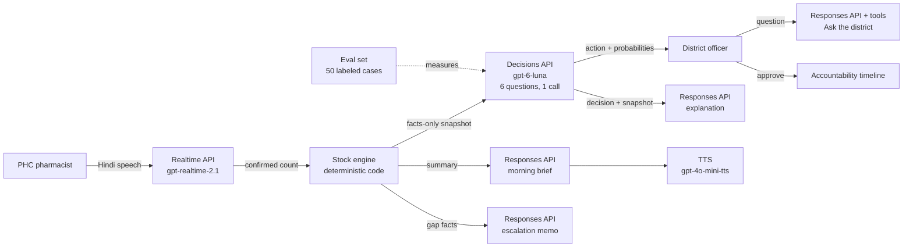

# OpenAI platform overview

Dawai Dost is built on the OpenAI platform. The **Decisions API** is the center: it chooses the next district action. The **Realtime API** collects the shelf count by voice in Hindi. The **Responses API** with structured outputs writes the briefs, explanations, indents, and memos, and answers questions with function tools. The **audio APIs** read briefs aloud and understand spoken questions from patients. An **eval set** measures how well the Decisions API picks the right action.

## APIs and models

| API | Model (default) | Task in Dawai Dost | Route | Doc |
| --- | --- | --- | --- | --- |
| **Decisions API** | `gpt-6-luna` | Choose one of four actions, plus urgency, recount, indent timing, and donor, in one call | `/api/decisions/district`, `/api/decisions/batch`, `/api/decisions` | [Decisions API](decisions-api.md) |
| **Realtime API** | `gpt-realtime-2.1` | Voice check-in in Hindi over WebRTC | `/api/realtime/session` | [Realtime API](realtime-api.md) |
| Responses API, structured outputs | `gpt-5.4-mini` | Explain a decision in English and Hindi | `/api/explain` | [Responses API](responses-api.md) |
| Responses API, structured outputs | `gpt-6-sol` | Write the officer's morning brief in English and Hindi | `/api/briefing` | [Responses API](responses-api.md) |
| Responses API, function tools, streaming | `gpt-5.5` | Answer free questions about the district from tool results | `/api/ask` | [Responses API](responses-api.md) |
| Responses API, structured outputs | `gpt-5.4-mini` | Write indent justifications; code sets every quantity | `/api/indent` | [Responses API](responses-api.md) |
| Responses API, structured outputs | `gpt-5.5` | Draft the escalation memo to the state; every number is checked | `/api/escalations/memo` | [Responses API](responses-api.md) |
| Responses API, structured outputs | `gpt-5.4-mini` | Map a patient's question to medicine and place ids | `/api/find/ask` | [Responses API](responses-api.md) |
| Text to speech | `gpt-4o-mini-tts` | Read the brief and Find medicine answers aloud | `/api/briefing/speech`, `/api/find/speak` | [Audio](audio.md) |
| Speech to text | `gpt-4o-mini-transcribe` | Transcribe a spoken Find medicine question | `/api/find/ask` | [Audio](audio.md) |
| Decisions API evals | `gpt-6-luna` and others | Measure accuracy and calibration on 50 labeled cases | `scripts/evals/run.ts` | [Evals](evals.md) |

## Why OpenAI for this problem

**Bounded decisions, not free text.** The Decisions API returns one choice from a closed list, with a probability for each choice. It can also answer score and yes/no questions in the same call. A district system needs exactly this: an action it can show, validate, log, and approve.

**Voice in Indian languages.** The Realtime API speaks and listens in Hindi with low latency. A pharmacist can report stock in a natural conversation. This removes the form, which is the main reason clinic reporting fails.

**Typed text from facts.** Structured outputs let each Responses API feature return JSON that the server checks with a schema. The model writes the words. Code supplies the numbers.

**One platform, one key.** All APIs use the same server-side key. The browser receives only a short-lived client secret for Realtime audio.

**Measurable quality.** The eval set grades the Decisions API against a written labeling policy and against the product's own rule-based fallback.

## The division of work

| Task | Owner | Reason |
| --- | --- | --- |
| Talk with the pharmacist | Realtime API | Natural speech in the local language |
| Calculate days of stock, surplus, gaps, indent quantities | Code | Arithmetic must be exact and auditable |
| Choose the next action and its urgency | Decisions API | Judgment across many signals, with a bounded output |
| Explain, brief, draft, and answer | Responses API | Clear language in English and Hindi, from computed facts |
| Approve the action | District officer | Medicine movement needs an accountable person |

The models never set a stock number, and the code never makes the operational judgment.

## Configuration

| Variable | Default | Purpose |
| --- | --- | --- |
| `OPENAI_API_KEY` | none | Server-side key for all APIs |
| `OPENAI_DECISIONS_MODEL` | `gpt-6-luna` | Decisions API model |
| `OPENAI_REALTIME_MODEL` | `gpt-realtime-2.1` | Reported by `/api/health` |
| `OPENAI_EXPLAIN_MODEL` | `gpt-5.4-mini` | Decision explanation |
| `OPENAI_BRIEFING_MODEL` | `gpt-6-sol` | Morning brief |
| `OPENAI_ASK_MODEL` | `gpt-5.5` | Ask the district |
| `OPENAI_INDENT_MODEL` | `gpt-5.4-mini` | Indent drafting |
| `OPENAI_MEMO_MODEL` | `gpt-5.5` | Escalation memo |
| `OPENAI_TTS_MODEL` | `gpt-4o-mini-tts` | Briefing speech |
| `OPENAI_FIND_TRANSCRIBE_MODEL` | `gpt-4o-mini-transcribe` | Find medicine speech to text |
| `OPENAI_FIND_PARSE_MODEL` | `gpt-5.4-mini` | Find medicine question parsing |
| `OPENAI_FIND_TTS_MODEL` | `gpt-4o-mini-tts` | Find medicine spoken answer |

`GET /api/health` reports whether a key is configured (`live` or `demo` mode) and the Decisions and Realtime model names. It never returns the key.

Without a key, the full workflow still runs with clearly labeled demo responses. See [Reliability and safety](../architecture/reliability-and-safety.md).
