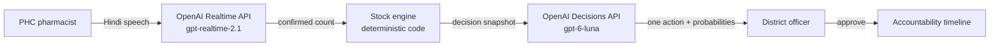

# OpenAI platform overview

Dawai Dost uses two OpenAI APIs. Each API has one clear task. Together they make the full loop from a spoken shelf count to an approved district action.

## The two APIs

| API | Model | Task in Dawai Dost | Endpoint |
| --- | --- | --- | --- |
| Realtime API | `gpt-realtime-2.1` | Hold a short voice conversation in Hindi with the clinic pharmacist | `POST /v1/realtime/client_secrets`, `POST /v1/realtime/calls` |
| Decisions API | `gpt-6-luna` (configurable) | Select the next operational action from four defined actions | `POST /v1/decisions` |

## Why OpenAI for this problem

**Voice in Indian languages.** The Realtime API speaks and listens in Hindi with low latency. A pharmacist can report stock in a natural conversation. This removes the form, which is the main reason clinic reporting fails.

**Structured decisions, not free text.** The Decisions API returns one choice from a closed list, with a probability for each choice. A district system needs exactly this: an action it can show, validate, log, and approve. See [Decisions API](decisions-api.md).

**One platform, one key.** Both APIs use the same server-side key. The browser receives only a short-lived client secret for audio. This keeps the security model simple.

**A clear path to production.** The same platform supports phone-line calls (Realtime over SIP), structured extraction of counts from speech, and agent workflows for follow-up tasks. The [roadmap](../product/roadmap.md) uses each of these.

## The division of work

Dawai Dost gives each part the task it does best:

| Task | Owner | Reason |
| --- | --- | --- |
| Talk with the pharmacist | Realtime API | Natural speech in the local language |
| Calculate days of stock and safe surplus | Code | Arithmetic must be exact and auditable |
| Choose the next action | Decisions API | Judgment across many signals, with a bounded output |
| Approve the action | District officer | Medicine movement needs an accountable person |

The models never set a stock number, and the code never makes the operational judgment. This separation makes the system both intelligent and trustworthy.

## Configuration

| Variable | Default | Purpose |
| --- | --- | --- |
| `OPENAI_API_KEY` | none | Server-side key for both APIs |
| `OPENAI_DECISIONS_MODEL` | `gpt-6-luna` | Model for the Decisions API |

Without a key, the full workflow still runs with clearly labeled demo responses. See [Reliability and safety](../architecture/reliability-and-safety.md).
