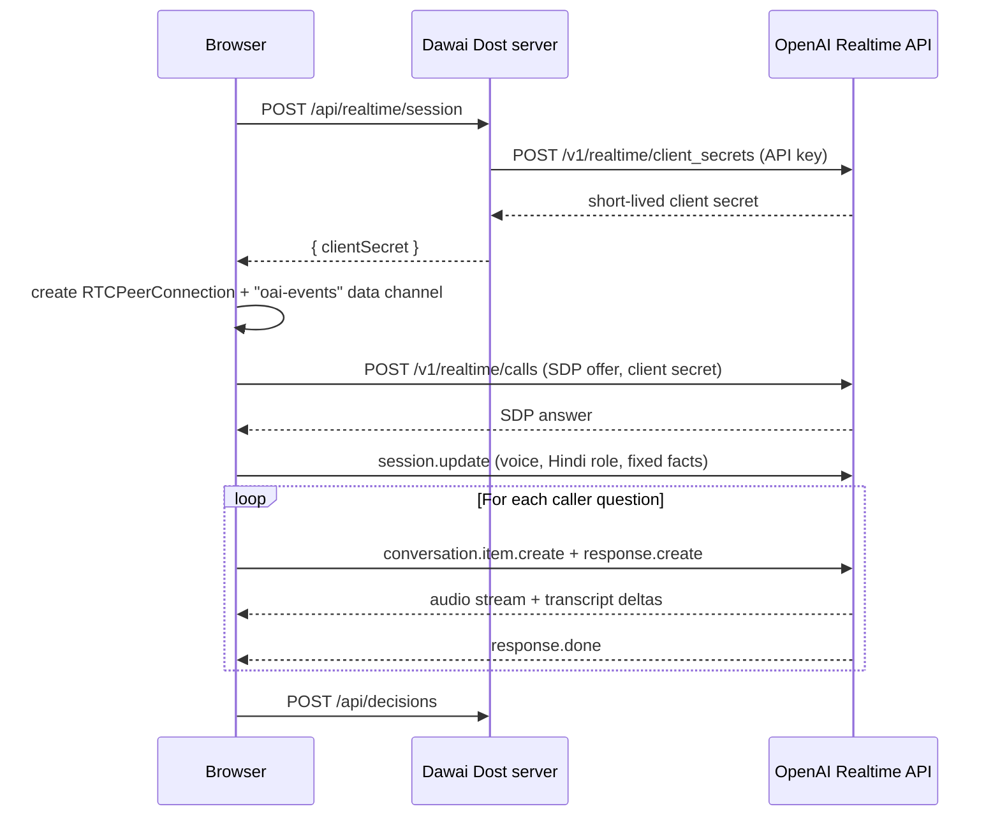

# Realtime API

The OpenAI Realtime API powers the voice check-in. A pharmacist reports the shelf count in Hindi, in a natural conversation, with no form.

Source: [`app/api/realtime/session/route.ts`](../../app/api/realtime/session/route.ts), [`app/page.tsx`](../../app/page.tsx)

## Why voice

Clinic stock reporting fails when it is slow and difficult. A pharmacist at a busy PHC does not have time to open an app and fill in a form. A phone call is different. It is familiar, it needs no smartphone, and it takes less than a minute.

The SMS for Life pilot showed that weekly reporting works when it is simple: facilities answered 95% of weekly requests. Voice makes reporting even simpler, because the pharmacist only speaks. See [Prior art](../research/prior-art.md).

## Connection flow

The standard API key never reaches the browser. The server creates a short-lived client secret, and the browser connects directly to OpenAI over WebRTC for low-latency audio.

## Session configuration

| Setting | Value | Reason |
| --- | --- | --- |
| Model | `gpt-realtime-2.1` | Low-latency speech in Hindi |
| Output | audio | The pharmacist hears a natural voice |
| Voice | `marin` | Clear and warm |
| Instructions | Hindi pharmacist role with fixed facts | Keeps the conversation on the stock report |

The instructions give the model a fixed set of facts: 16 strips of Metformin 500 mg, recount confirmed, about 8 strips used each day, resupply in about 5 days. The model must not invent quantities, give medical advice, or choose a district action.

## Event handling

The browser drives the call with Realtime events on the `oai-events` data channel:

| Event | Direction | Use |
| --- | --- | --- |
| `session.update` | Browser to OpenAI | Set the voice, role, and facts |
| `conversation.item.create` | Browser to OpenAI | Send the next caller question |
| `response.create` | Browser to OpenAI | Ask for a spoken answer |
| `response.output_audio_transcript.delta` | OpenAI to browser | Stream the answer text into the live transcript |
| `response.done` | OpenAI to browser | Move to the next question, or end the call |
| `error` | OpenAI to browser | Change to the sample call |

When the last answer is complete, the dashboard starts the decision step automatically. The officer sees the transcript, the stock forecast, and the recommendation on one screen.

## Fallback

If the session cannot start, the connection does not open within 12 seconds, or the API sends an error, the dashboard plays a scripted sample call. The sample call is labeled. The rest of the workflow continues without change.

## In the demo and in production

In the demo, the browser plays the role of the district caller, and the Realtime model plays a fictional pharmacist. This lets judges hear the conversation from a laptop.

In production, the roles change: the Realtime model is the caller, and a real pharmacist answers on a normal phone. The Realtime API supports SIP phone calls, so the same session design can connect to a phone line. The model will ask for the count, confirm it, and ask for a recount when the number does not agree with expected use. Structured extraction will then turn the confirmed count into a stock record. See the [roadmap](../product/roadmap.md).
