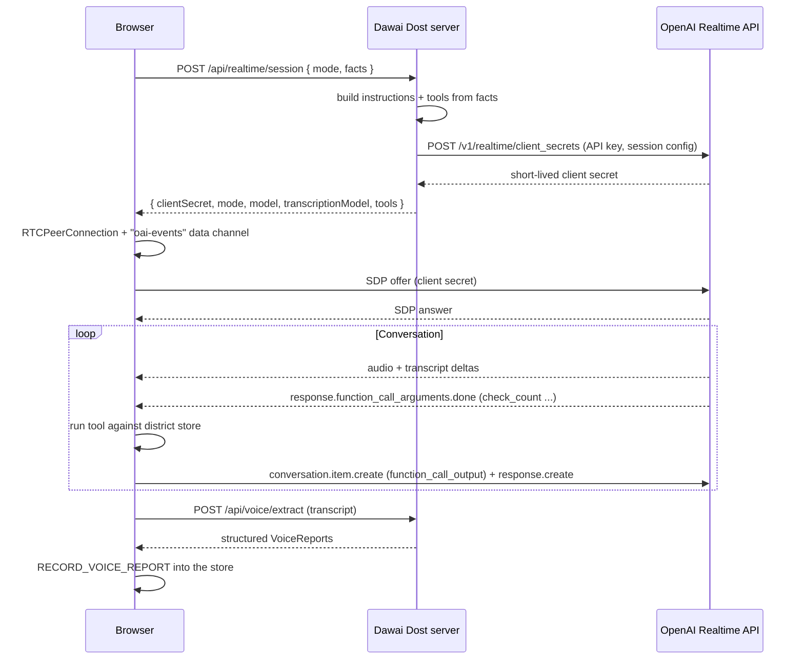

# Realtime API

The OpenAI Realtime API powers the voice check-in. A pharmacist reports shelf counts in Hindi, in a natural conversation, with no form. The same voice line can also answer an ASHA worker or a patient who asks whether a medicine is in stock.

Source: [`app/api/realtime/session/route.ts`](../../app/api/realtime/session/route.ts), [`lib/voice/instructions.ts`](../../lib/voice/instructions.ts), [`components/voice/useRealtimeCall.ts`](../../components/voice/useRealtimeCall.ts), [`components/voice/VoiceConsole.tsx`](../../components/voice/VoiceConsole.tsx)

## Why voice

Clinic stock reporting fails when it is slow and difficult. A pharmacist at a busy PHC does not have time to open an app and fill in a form. A phone call is different. It is familiar, it needs no smartphone, and it takes less than a minute.

The SMS for Life pilot showed that weekly reporting works when it is simple: facilities answered 95% of weekly requests. Voice makes reporting even simpler, because the pharmacist only speaks. See [Prior art](../research/prior-art.md).

## Three voice modes

The voice console on the **Voice check-ins** page (`/voice`) has three modes. Each mode gets its own instructions and tools, built on the server from facts only.

| Mode | UI label | Who speaks | What Realtime does | Tools |
| --- | --- | --- | --- | --- |
| `pharmacist_sim` | Simulated pharmacist | The browser asks the questions | Plays the PHC pharmacist with that facility's synthetic counts | none |
| `caller_agent` | You are the pharmacist | You, into the microphone, in Hindi | Acts as the Dawai Dost check-in agent: asks for each count, checks it, reads it back | `check_count`, `confirm_count`, `end_call` |
| `availability` | Availability line | You, as an ASHA worker or patient | Answers "is this medicine available at this PHC?" from the district store | `check_availability` |

`caller_agent` is the production design: the AI calls the pharmacist. `pharmacist_sim` lets a judge hear a full call from a laptop with no microphone.

## The check-in agent (`caller_agent`)

The agent follows a fixed flow, in Hindi, with each turn under two short sentences:

1. Greet the pharmacist by name and ask for the first medicine's shelf count.
2. When the pharmacist says a number, call **`check_count`** with the medicine id and the number. The browser compares the number with the expected range from the facility's ledger and returns `plausible` or `implausible`.
3. If plausible, read the number back in Hindi (for example "मेटफॉर्मिन — सोलह स्ट्रिप, सही?"). When the pharmacist confirms, call **`confirm_count`**.
4. If not plausible, ask for a recount of that shelf. The agent **never reveals the expected number**, so it cannot lead the answer. If the pharmacist repeats the same number, the agent accepts it with `pharmacist_insisted: true`.
5. After the last medicine, thank the pharmacist and call **`end_call`** with a one-line English summary.

The expected range ([`lib/voice/facts.ts`](../../lib/voice/facts.ts)) uses the same ledger rule as the store's count check, so the agent and the store agree:

```text
expected  = last week's closing stock + units received this week − daily use × days since the week began
tolerance = max(3, daily use × 3.5, expected × 0.25)
plausible = expected − 1.5 × tolerance  ≤  count  ≤  expected + tolerance
```

The rule shared by every mode: **the voice model never invents quantities.** Counts come only from what the pharmacist says.

## The availability line (`availability`)

An ASHA worker or a patient asks about a medicine at a health centre. For every question the model must call **`check_availability`** first. The tool answers from the district store ([`lib/voice/availability.ts`](../../lib/voice/availability.ts)) and returns the nearest facility with stock when the medicine is not available. The model says "available", "running low", or "not available". It does not say exact unit counts to patients. It gives no medical or dosage advice, and for an emergency it tells the caller to dial 108.

## Connection flow

The standard API key never reaches the browser. The server creates a short-lived client secret (10 minutes), and the browser connects directly to OpenAI over WebRTC for low-latency audio.



## Session configuration

| Setting | Value | Reason |
| --- | --- | --- |
| Model | `gpt-realtime-2.1` | Low-latency speech in Hindi |
| Output | audio, voice `marin` | A clear, warm voice |
| Input transcription | `gpt-transcribe`, languages `hi` and `en` | Live captions of what the pharmacist says |
| Transcription keywords | Medicine names (English and Hindi), facility names, "Dawai Dost", "स्ट्रिप", "PHC" | Better spelling of local names |
| Noise reduction | `near_field` | Phone-style microphone input |
| Turn detection | `semantic_vad`; eagerness `low` for the check-in agent | The agent waits while the pharmacist counts |
| Client secret lifetime | 600 seconds | One session only |

Microphone input, transcription, and turn detection are on only in `caller_agent` and `availability` modes.

## Event handling

| Event | Direction | Use |
| --- | --- | --- |
| `conversation.item.create` | Browser to OpenAI | Send a scripted question (simulated mode) or a tool result |
| `response.create` | Browser to OpenAI | Ask for the next spoken turn |
| `response.output_audio_transcript.delta` / `.done` | OpenAI to browser | Stream the model's words into the live transcript |
| `conversation.item.input_audio_transcription.delta` / `.completed` | OpenAI to browser | Stream the speaker's words into the transcript |
| `response.function_call_arguments.done` | OpenAI to browser | Run `check_count`, `confirm_count`, `end_call`, or `check_availability` |
| `response.done` | OpenAI to browser | Move to the next turn |

The console shows each tool call in the transcript, for example `check_count(metformin-500, 16) → plausible`.

## From speech to the stock record

When the call ends, the browser sends the transcript to `POST /api/voice/extract`. The Responses API (`gpt-5.4-mini`) extracts one count per medicine with structured outputs. Hindi number words become digits (for example सोलह = 16, डेढ़ सौ = 150). Counts confirmed through `confirm_count` take priority. Code then validates each report, and the store runs the count check. A flagged count or an extraction confidence below 0.6 opens a recount. See [Responses API](responses-api.md#voice-report-extraction).

The **Structured report → district store** panel shows the extracted counts. When the reports are saved, the console shows **Recorded · map updated**.

## Fallbacks

| Failure | Behavior |
| --- | --- |
| No key | `/api/realtime/session` returns 503. The console plays a labeled sample call. |
| Microphone blocked or missing | The console explains the problem and plays a labeled sample call. |
| No connection within 12 seconds | "Realtime did not connect within 12 seconds." Then a labeled sample call. |
| API error before the conversation starts | The console switches to a labeled sample call. |
| Extraction fails | A deterministic Hindi number parser extracts the counts, labeled as fallback. |

The sample call is labeled **Sample call · scripted**. The rest of the workflow continues without change.

## The check-in roster

The **Call roster** on the same page lists every facility's weekly check-in. **Run all due calls** runs the due calls one after another, with simulated pharmacist answers and live structured extraction, and writes each result to the store.

## In the demo and in production

In the demo, a judge can either listen to a simulated pharmacist or speak as the pharmacist. In production, the Realtime model calls a real pharmacist on a normal phone. The Realtime API supports SIP phone calls, so the same `caller_agent` instructions and tools can connect to a phone line. See the [roadmap](../product/roadmap.md).
