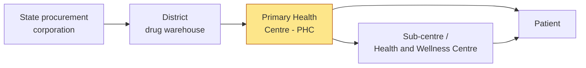

# Problem landscape

This document collects the research on medicine availability in Indian public health facilities. It explains where the supply chain loses visibility and why that matters for patients.

## How medicine reaches a rural patient

States buy medicines centrally and store them in district warehouses. Many states use warehouse software, such as the Drug and Vaccine Distribution Management System (DVDMS), to record stock and dispatch. The warehouse knows what it sends to each PHC.

The gap is at the PHC (highlighted). After a box arrives, the district cannot easily see how much remains on the shelf or how fast it is used. Indents from the PHC are often late or based on estimates. The first clear signal of a stockout is often an empty shelf in front of a patient.

## What the studies show

### ICMR multi-state survey, 2025

The Indian Council of Medical Research surveyed **415 public and private facilities** in **19 districts** across **seven states**. Data collection took place from September to December 2021 and from February to June 2023. The survey measured readiness for diabetes and hypertension care.[^icmr]

| Facility level | Medicine | Facilities reporting stockout | Median stockout duration |
| --- | --- | ---: | ---: |
| Sub-centre | Metformin | 35.2% | 7 months |
| Sub-centre | Glimepiride | 50.5% | 3 months |
| Sub-centre | Atenolol | 68.5% | 4 months |
| Sub-centre | Amlodipine | 44.8% | 7 months |
| PHC | Metformin | 6% | |
| PHC | Glimepiride | 12% | |
| PHC | Atenolol | 29% | |

PHCs scored **66%** on the medicine domain. Neither PHCs nor sub-centres met the 70% preparedness threshold.

Two findings are important for Dawai Dost:

1. **Stockouts last months, not days.** A seven-month stockout is not a delivery delay. It is a failure of information and response.
2. **PHCs are the hub.** PHCs have better stock than sub-centres. They supply the facilities below them. Good visibility at the PHC level helps the whole local network.

### Punjab and Haryana

A PGIMER-led study surveyed **80 public facilities in 12 districts**. Overall essential-medicine availability was **45.2%** in Punjab and **51.1%** in Haryana.[^pgimer]

### Chhattisgarh

Researchers checked **1,290 prescriptions** from **100 public facilities**. Patients received about **58%** of prescribed generic medicines at the facility. For the remainder, patients had to buy the medicine elsewhere or go without it.[^chhattisgarh]

### Puducherry

A survey of **10 public facilities** found median availability of **76%** across 50 key medicines, with a range of 66% to 80%.[^puducherry]

### WHO reference

The WHO uses **80%** availability as a reference target for a defined set of essential medicines.[^who] Most of the sampled facilities above are below this value.

## What a stockout costs

For a patient with diabetes or hypertension, a PHC stockout has three costs:

- **Money.** The patient buys the same medicine at a private pharmacy, often at a higher price.
- **Time.** The patient travels to the PHC, finds no stock, and must travel again.
- **Health.** Some patients stop treatment. For chronic disease, a gap in treatment increases the risk of complications.

For the health system, each stockout also reduces trust. A patient who finds an empty shelf twice may not come back.

## Where the system loses visibility

Studies of Indian state supply chains describe the same pattern:

- Uttar Pradesh redesigned its public-medicine supply chain with a warehouse data model and procurement reforms. The remaining challenge was **last-mile visibility** below the district store.[^up]
- An NHM Odisha rapid assessment reported that drug-indenting software was not in use at the stores it assessed.[^odisha]
- An XKDR Forum working paper on medicine supply in India recommends better **stock and flow information** across the chain.[^xkdr]

The warehouse layer is improving. The shelf layer is still mostly invisible. Dawai Dost is designed for exactly this layer.

[^icmr]: [ICMR/IJMR: Preparedness of public and private health facilities for diabetes and hypertension in 19 districts](https://pmc.ncbi.nlm.nih.gov/articles/PMC12178186/)
[^pgimer]: [Availability of medicines in public sector facilities in Punjab and Haryana](https://pubmed.ncbi.nlm.nih.gov/26699711/)
[^chhattisgarh]: [Access and availability of essential medicines in public facilities in Chhattisgarh](https://pmc.ncbi.nlm.nih.gov/articles/PMC5958558/)
[^puducherry]: [Availability of key essential medicines in public health facilities in Puducherry](https://pmc.ncbi.nlm.nih.gov/articles/PMC8654139/)
[^who]: [WHO: Access indicators for essential medicines](https://www.who.int/tools/monitoring-and-evaluation/access-indicators)
[^up]: [Lessons from redesigning Uttar Pradesh's public-medicine supply chain](https://pmc.ncbi.nlm.nih.gov/articles/PMC12333384/)
[^odisha]: [NHM Odisha: Rapid assessment of drug availability and stockouts](https://nhmodisha.gov.in/wp-content/uploads/2024/02/12.-Draft-Drug-Stock-Out-Assessment-including-recommendations-for-the-procurement-system-identification-of-issues-arising-and-mitigation-plan-agreed-with-DHFW.pdf)
[^xkdr]: [XKDR Forum: Improving supply chain management of medicines for public healthcare in India](https://papers.xkdr.org/papers/2024Manivannanetal_rp_governmentProcurementDrugsIndia.pdf)
